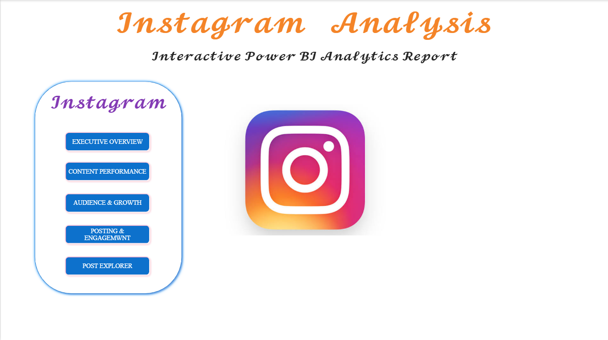
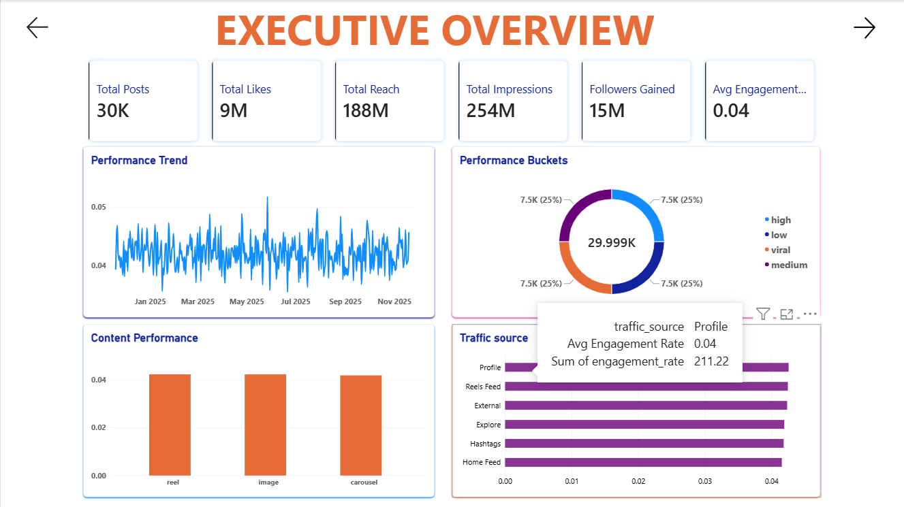
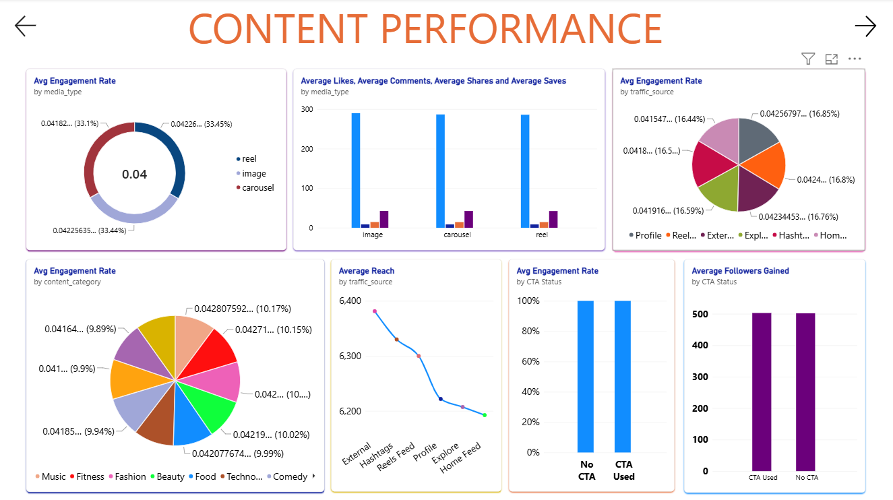
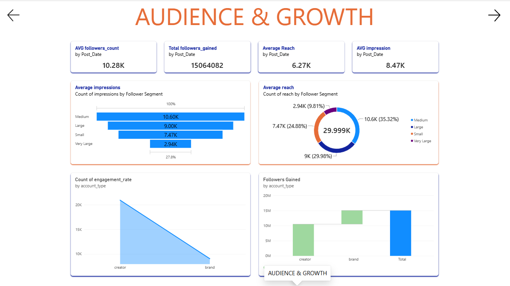
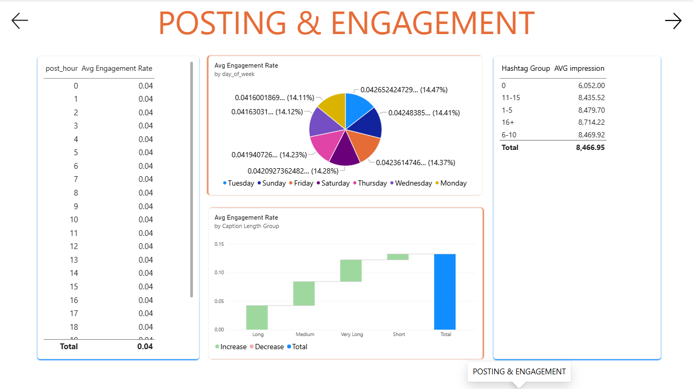
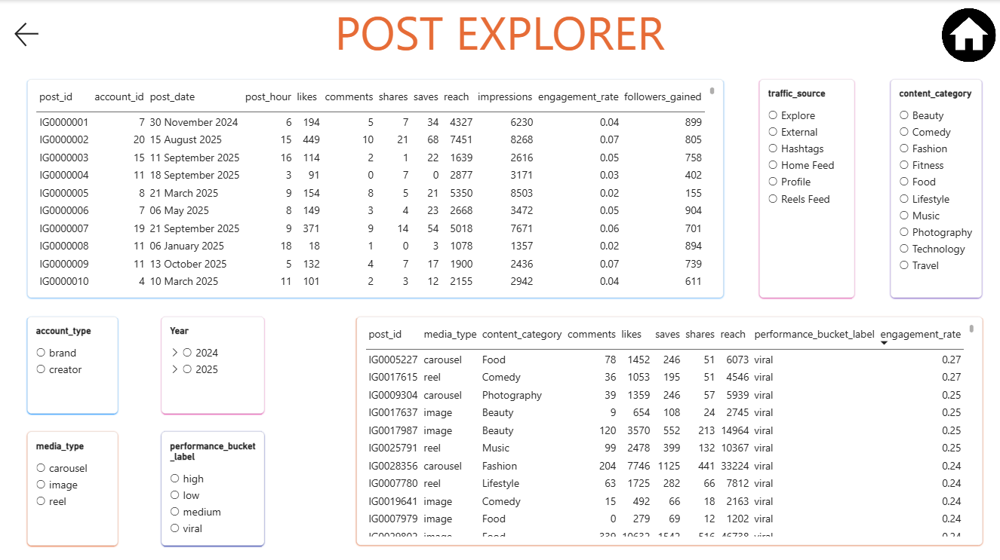

# Instagram Trend Analysis Dashboard

## Project Overview

The **Instagram Trend Analysis Dashboard** is an interactive Power BI
report built to explore Instagram content performance, audience growth,
engagement patterns, and posting trends. It brings key metrics and
different views of post performance into one report to support easier
analysis and comparison.

## Project Objectives

-   Monitor key Instagram performance indicators.
-   Explore engagement across different media types and content
    categories.
-   Understand audience and follower-growth patterns.
-   Compare performance by traffic source, account type, posting day,
    and posting hour.
-   Review individual posts and filter the analysis to investigate
    specific content.

## Tools and Technologies

-   **Microsoft Power BI** --- dashboard development and data
    visualization
-   **Power Query** --- data preparation and transformation
-   **DAX** --- measures and calculated metrics
-   **Calendar table** --- date-based analysis and filtering

## Dashboard Pages

### 1. Home

The landing page for navigating the report.

### 2. Executive Overview

Provides a high-level view of performance, including metrics such as
total posts, total likes, total reach, total impressions, followers
gained, and average engagement rate. It also includes trend and
performance breakdown visuals.

### 3. Content Performance

Explores how content performs across media types, traffic sources, and
content categories. It includes comparisons of engagement and audience
response, including likes, comments, shares, and saves.

### 4. Audience & Growth

Focuses on audience-related measures such as average reach, average
impressions, followers gained, follower segments, and account-type
patterns over time.

### 5. Posting & Engagement

Examines engagement patterns by posting hour, day of the week, hashtag
group, and caption-length group to support comparisons of posting
approaches.

### 6. Post Explorer

Provides a detailed view of individual posts. Interactive slicers allow
the report to be filtered by date, traffic source, account type, media
type, content category, and performance group.

## Key Metrics and Analysis

The report includes metrics and views for:

-   Total Posts
-   Total Likes
-   Total Reach
-   Total Impressions
-   Followers Gained
-   Average Engagement Rate
-   Average Likes, Comments, Shares, and Saves
-   Average Reach and Average Impressions
-   Engagement and performance comparisons by media type, content
    category, traffic source, and posting time

*The metrics shown depend on the selected page and active filters. This
README describes the fields and visuals present in the report; it does
not claim specific performance results.*

## Interactivity

The report includes interactive visualizations and slicers to help users
explore the data from different angles. Date, account type, traffic
source, media type, content category, and performance-group filters are
available in the detailed post exploration view.

## Repository Contents

-   `Project_Instagram.pbix` --- Power BI report file
-   `Screenshots/` --- dashboard screenshots (add screenshots here when
    available)
-   `README.md` --- project documentation

## How to View the Project

1.  Download the `.pbix` file from this repository.
2.  Open it using Microsoft Power BI Desktop.
3.  Use the report pages and slicers to explore the available metrics
    and visualizations.

## Skills Demonstrated

-   Data analysis and reporting
-   Power BI dashboard development
-   Data visualization
-   DAX-based KPI analysis
-   Date-based and category-based analysis
-   Interactive report design

## Dashboard Preview

Add screenshots of the report pages below to make the project easier to
preview on GitHub.

Suggested screenshots: - Executive Overview - Content Performance -
Audience & Growth - Posting & Engagement - Post Explorer

------------------------------------------------------------------------

**Project:** Instagram Trend Analysis Dashboard\
**File:** `Project_Instagram.pbix`
